# Capturas de main
Commit `4e3b50d` — 2026-11-11 03:20 UTC

## 01_arena.png

## 02_sword_slash.png

## 03_heavy_strike.png

## 04_impact.png

## 04a2_loadout_panel.png
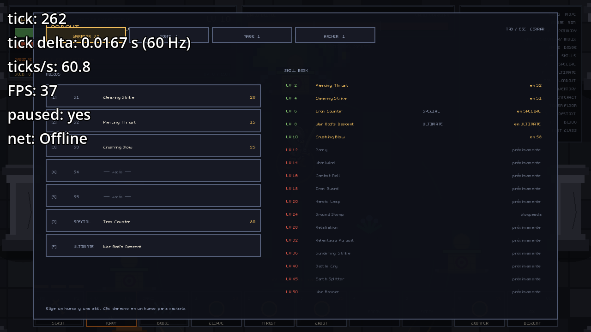

## 04a3_iron_counter_stance.png
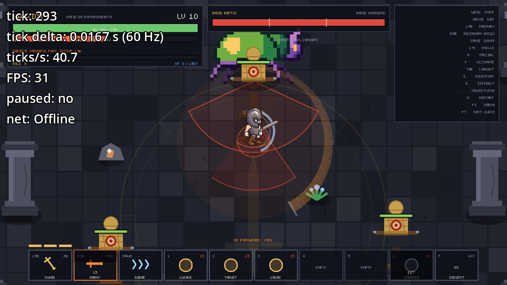

## 04a_level10_hud.png
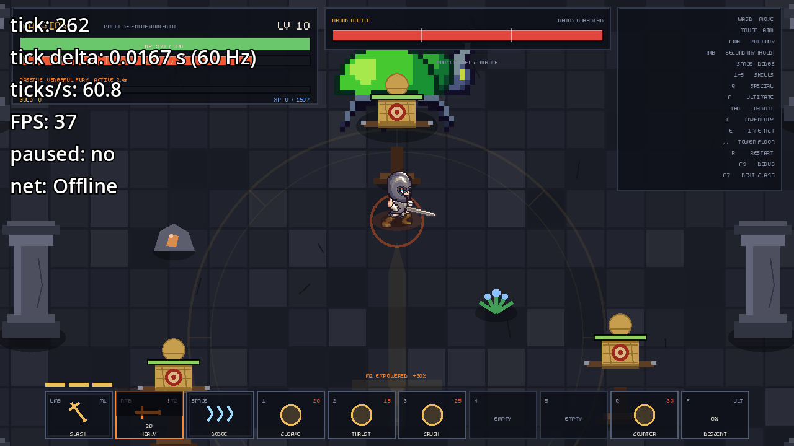

## 04b_ultimate_telegraph.png

## 04c_ultimate_impact.png

## 04d_enemy_slime_cone.png
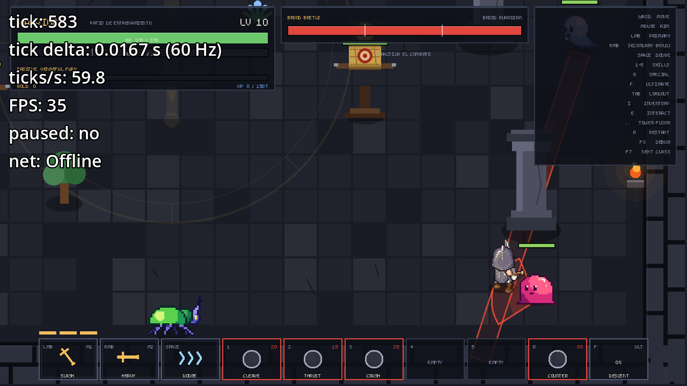

## 04e_enemy_bat_line.png
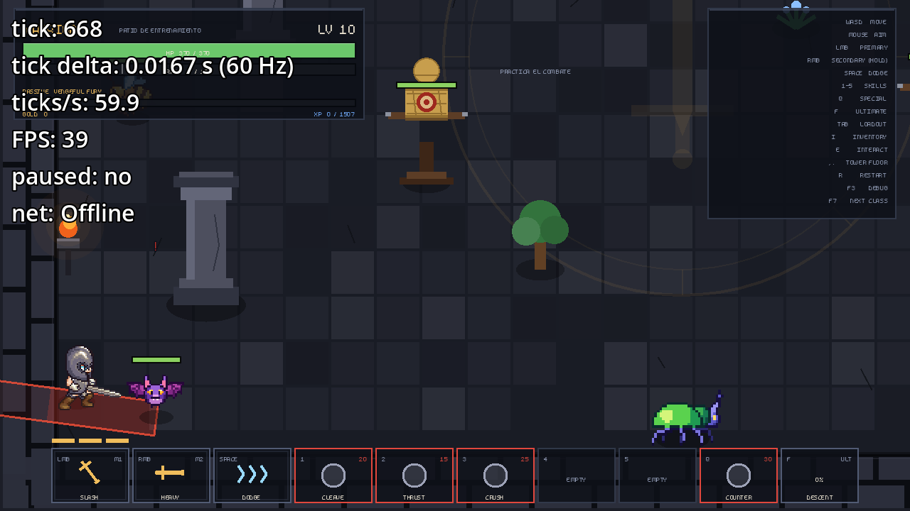

## 04f_enemy_spider_circle.png
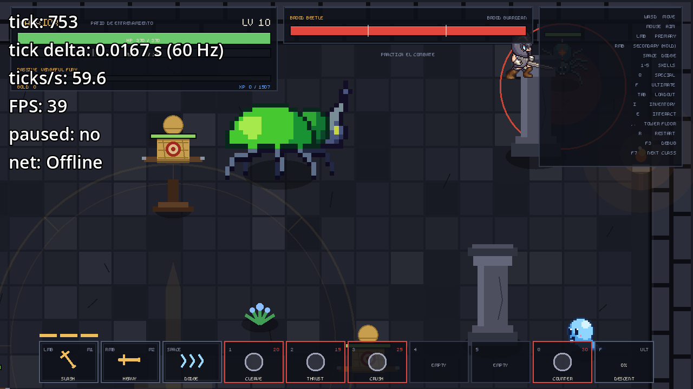

## 04g_enemy_beetle_cone.png
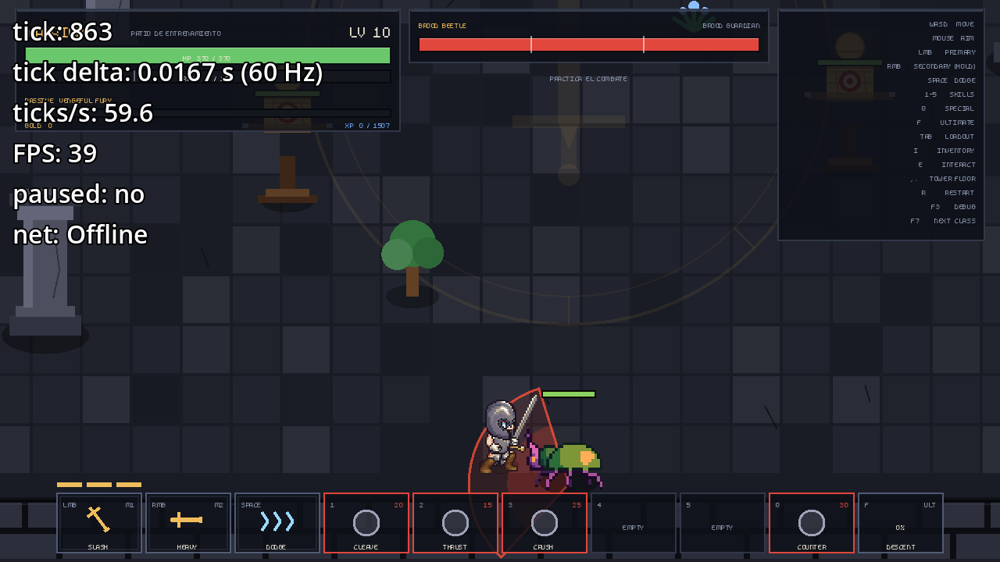

## 05_vengeful_fury.png

## 06_death.png

## gear_archer_1_default.png

## gear_archer_2_common.png

## gear_archer_2_epic.png
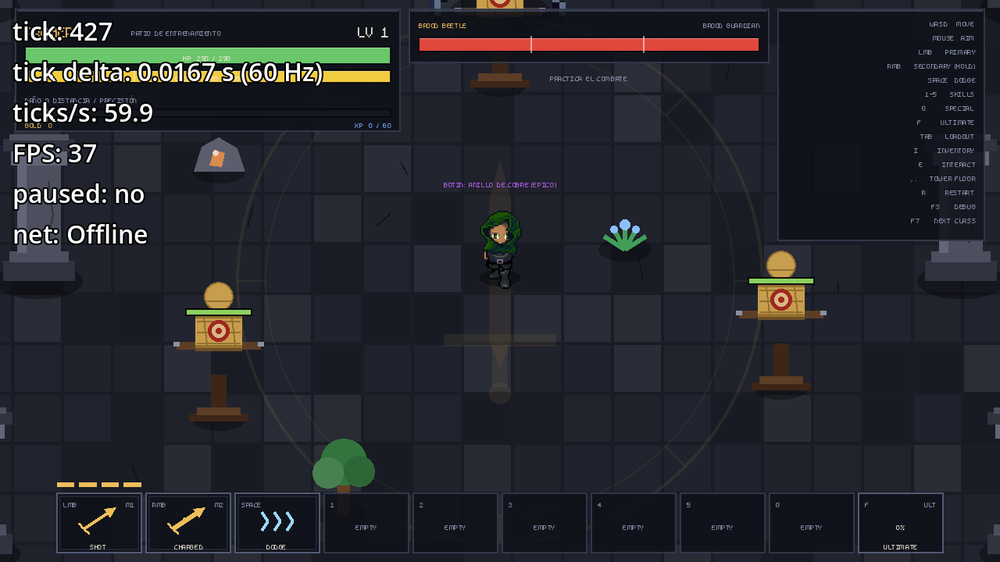

## gear_crafting.png
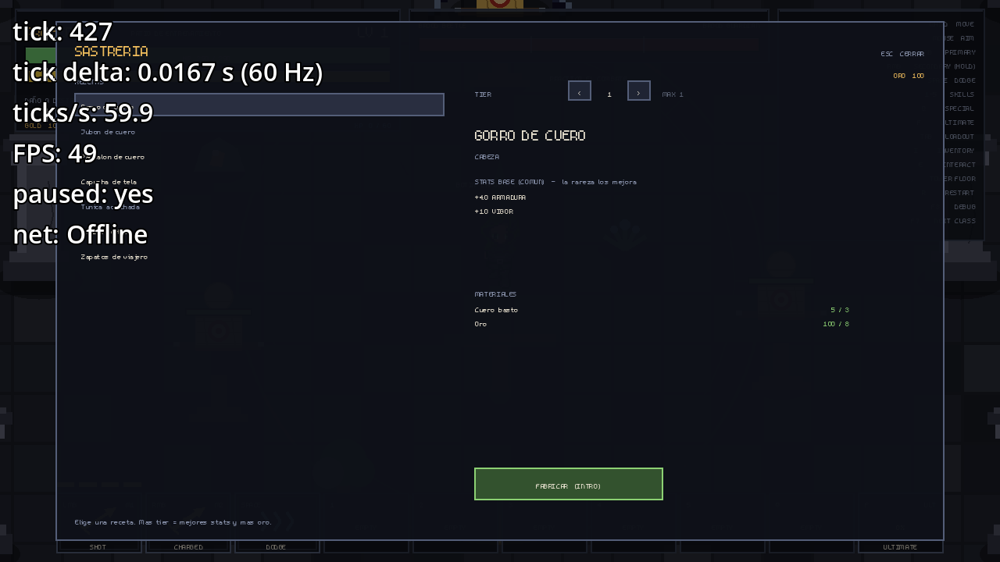

## gear_inventory.png
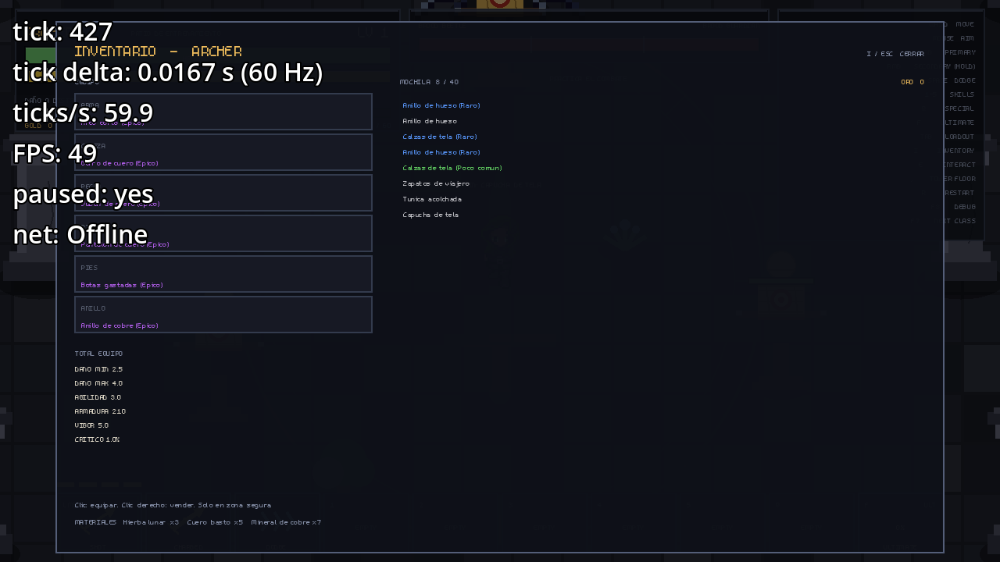

## gear_mage_1_default.png
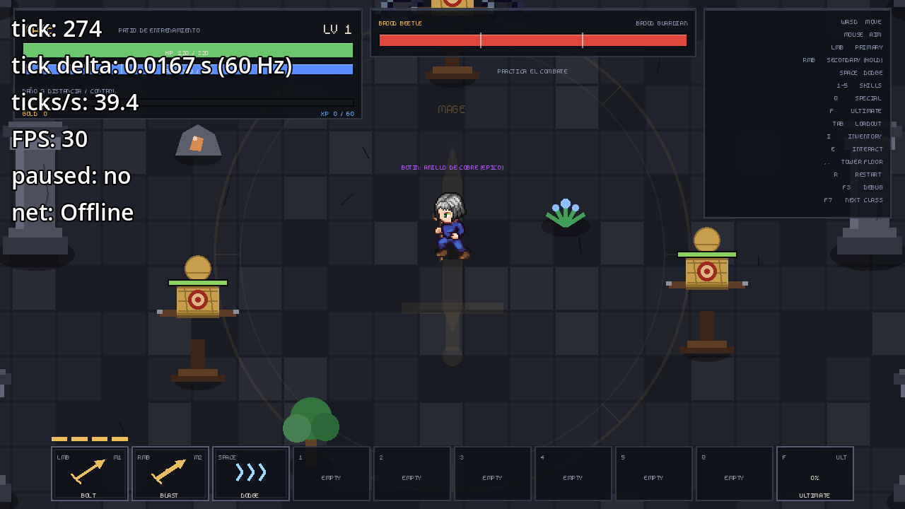

## gear_mage_2_common.png

## gear_mage_2_epic.png

## gear_rogue_1_default.png
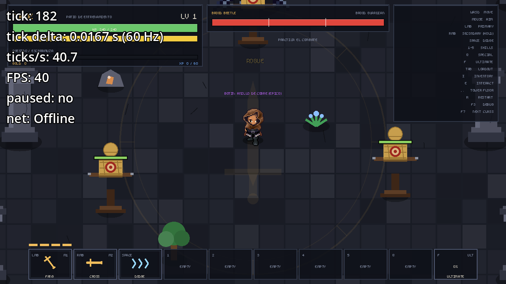

## gear_rogue_2_common.png

## gear_rogue_2_epic.png

## gear_sheet.png
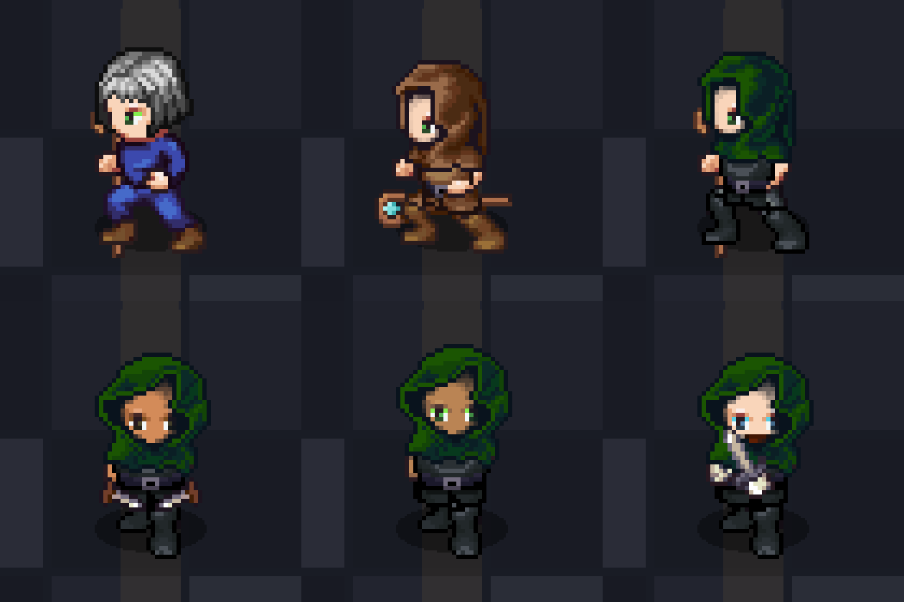

## gear_warrior_1_default.png
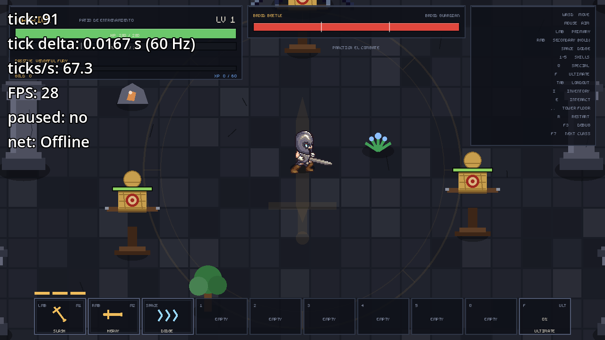

## gear_warrior_2_common.png
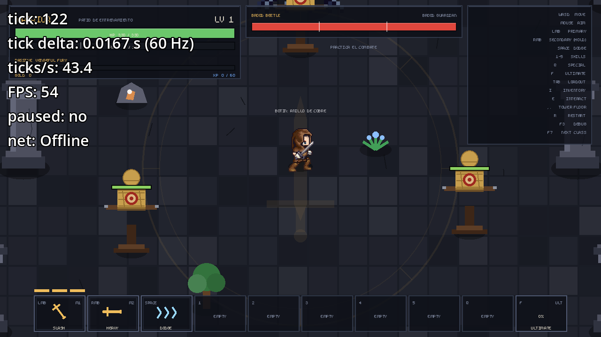

## gear_warrior_2_epic.png
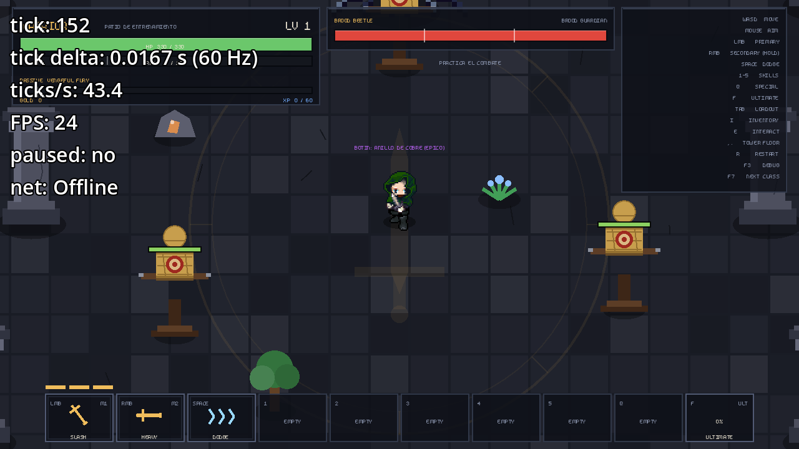
